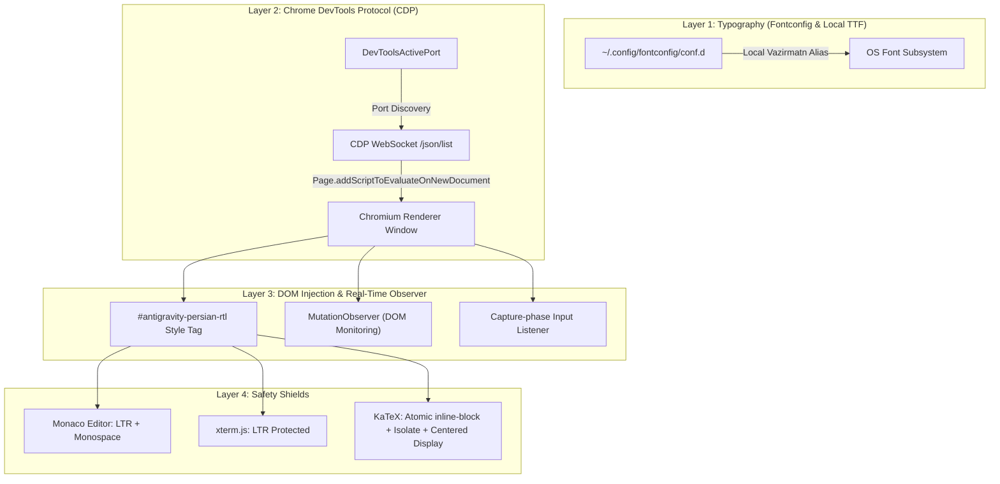

# Technical Code Documentation — Antigravity Persian RTL Suite

Comprehensive architectural, module, and execution documentation for the **Antigravity Persian RTL & Vazirmatn Suite**.

---

## 1. Directory & File Structure

```text
antigravity-persian-rtl/
├── autostart/
│   └── antigravity-rtl.desktop       # XDG Autostart entry for Linux desktops
├── bin/
│   └── fix-antigravity-rtl.js        # Core CDP injector & CLI management tool
├── config/
│   ├── 99-vazirmatn-antigravity.conf # Linux fontconfig fallback rules
│   └── gemini-persian-rule.md        # Assistant instructions for BiDi & KaTeX
├── macos/
│   └── com.antigravity.persian.plist # macOS LaunchAgent service definition
├── systemd/
│   └── antigravity-rtl.service       # Linux systemd user service definition
├── windows/
│   └── install.ps1                   # Windows PowerShell automated installer
├── .github/                          # Issue & PR templates, community standards
├── CODE_DOCUMENTATION.md             # This technical document
├── CONTRIBUTING.md                   # Community contribution guide
├── DESIGN_PHILOSOPHY.md              # Engineering decisions & constraints
├── LICENSE                           # MIT License
├── README.md                         # Main user guide (Farsi & English)
├── SECURITY.md                       # Vulnerability reporting protocol
├── install.sh                        # Universal Linux/macOS installer
└── uninstall.sh                      # Universal uninstaller
```

---

## 2. High-Level Architecture

The suite operates across **four distinct, non-invasive layers**:



---

## 3. Core Modules & Function Reference

All runtime logic is contained within [bin/fix-antigravity-rtl.js](bin/fix-antigravity-rtl.js), which requires **zero external npm dependencies** (pure Node.js standard library):

| Function | Scope | Description |
| :--- | :--- | :--- |
| `getPortFilePath()` | CLI / Host | Resolves `DevToolsActivePort` across Linux, macOS, and Windows. |
| `isRtlString(str)` | Injected / DOM | Google Closure-inspired BiDi ratio heuristic. Flags text as RTL if Persian/Arabic characters exceed 35% of directional letters or >= 3 Persian chars. |
| `updateElementDir(el)` | Injected / DOM | Dynamically calculates and applies `dir="rtl"` / `text-align: right` or `dir="ltr"` / `text-align: left` based on content. |
| `applyAutoDir(root)` | Injected / DOM | Scans target DOM subtree and applies dynamic directionality while strictly ignoring Monaco, xterm, and KaTeX. |
| `attachToPage(page)` | Host | Opens a WebSocket to the Chromium CDP endpoint, evaluates styles immediately, and registers `Page.addScriptToEvaluateOnNewDocument`. |
| `checkAndInject(silent)` | Host | Reads the active port, fetches active pages via `http://127.0.0.1:<port>/json/list`, and attaches to all UI pages. |
| `removeStylesFromWindows()` | Host / CDP | Disconnects the MutationObserver, removes the input listeners, strips the style tag, and cleans up all `data-ag-rtl` attributes. |
| `turnOn()` | CLI | Starts the OS background service and injects styles into all running windows. |
| `turnOff()` | CLI | Stops the OS service and reverts running windows to pristine stock styling. |
| `toggle()` | CLI | Toggles between active and inactive states. |
| `showStatus()` | CLI | Displays platform, active port, connected window count, and service health. |

---

## 4. KaTeX & Mathematical Equation Safety

KaTeX equations in an RTL environment suffer from character inversion because mathematical symbols (`=`, `*`, `(`, `)`, `[`, `]`, `\le`) are classified as neutral characters in the Unicode Bidirectional Algorithm (UBA).

To achieve 100% mathematical integrity:
1. **Inline Math (`.katex`)**: Styled with `display: inline-block !important` and `unicode-bidi: isolate !important`. This turns each formula into an atomic layout object (`\uFFFC`) that the outer RTL sentence cannot penetrate.
2. **Display Math (`.katex-display`)**: Styled with `display: block !important`, `margin: 1.2em 0 !important`, and `text-align: center !important`.

---

## 5. Execution Flow

1. **Service Startup**: `systemd` (Linux), `LaunchAgent` (macOS), or `Startup` (Windows) launches `fix-antigravity-rtl --daemon`.
2. **Polling Loop**: Every 2 seconds, the daemon checks for the existence of `DevToolsActivePort`.
3. **CDP Connection**: When Antigravity opens, the daemon reads the ephemeral port, connects via WebSocket, and compiles the injection script into every frame before paint.
4. **Interactive Typing**: As the user types in `contenteditable`, capture-phase listeners evaluate character ratios in real-time, instantly adjusting direction without lag.
